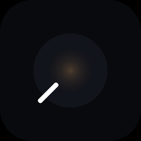

# Vesper — desktop



A dark, dial-driven desktop app for controlling smart lights over your **local
network** — no cloud account, no API tokens, no internet. Six brands behind one
vendor abstraction, driven by scenes, live effects and screen-sync.

**Works with:** LIFX · Philips Hue · WiZ · Yeelight · Nanoleaf · Govee
*(unofficial — not affiliated with or endorsed by any of these brands)*

## Two implementations

The app exists twice in this repo, sharing the same assets (`images/`,
`audio/`, `branding/`) and the same credential files (`hue.json`,
`nanoleaf.json`):

- **`native/` — Rust + egui. The one to use.** A single static `vesper.exe`
  with no runtime dependencies; window up in ~80 ms warm (the Python app takes
  ~10 s). Full feature parity: six vendors, scenes, effects, screen-sync,
  ambience, knobs.
- **`lifx_gui.py` — the original Python/Tkinter app**, kept as reference and
  for the asset tooling (`fetch_photos.py` re-rolls scene images; the native
  app doesn't).

## Requirements

- Your PC on the **same subnet** as the lights. Discovery binds every local
  interface and sends subnet-directed broadcasts, so it works even with a VPN
  owning the default route.
- Native build: `cargo build --release` in `native/` (Rust stable). Nothing
  else — audio and image decoding are compiled in.
- Python app only: Python 3 with Tkinter; optional Pillow + python-vlc.

## Run

Double-click **`Vesper.bat`** (prefers the native exe, falls back to Python),
or:

```powershell
native\target\release\vesper.exe     # native
python lifx_gui.py                   # python original
```

Hit **Discover**. Lights from every brand appear together, each card tagged with
its vendor. `vesper.exe --discover out.txt` runs a headless discovery +
ack-verification pass and writes the result to a file (diagnostic).

## Per-brand setup

| Brand | Setup |
|-------|-------|
| **LIFX** | None — discovered automatically. |
| **WiZ** | None — discovered automatically. |
| **Govee** | Enable *LAN Control* for the device in the Govee Home app. |
| **Yeelight** | Enable *LAN Control* for the bulb in the Yeelight app. |
| **Hue** | Press the bridge's round button, then click **+ Hue**. |
| **Nanoleaf** | Hold the panel's power button 5–7s (LEDs flash), then click **+ Nanoleaf**. |

Hue and Nanoleaf credentials are saved to `hue.json` / `nanoleaf.json`, both
gitignored.

## Features

- **33 scenes** with anime artwork; palette scenes re-shuffle colours across
  your bulbs on every tap. Right-click a tile to re-roll its image.
- **Live effects** — breathe, flow, undulate (breathe + flow: colours drift
  while brightness swells as a travelling wave), flicker, strobe — that animate
  the *current* scene's colours, capped at each bulb's set brightness, with a
  live speed knob.
- **Screen sync** — samples your screen and drives the lights to complement or
  augment it, with eased colour transitions.
- **Audio ambience** per scene (synth + real recordings).
- **VST-style knobs** everywhere; double-click any knob to reset it.

## Layout

| Native (Rust) | Python | Purpose |
|------|------|---------|
| `native/src/controller.rs` | `devices.py` | Multi-vendor controller; delegates to providers |
| `native/src/lifx.rs` | `lifx_lan.py` | LIFX LAN protocol (ack+retry, VPN-aware discovery) |
| `native/src/{hue,wiz,yeelight,nanoleaf,govee}.rs` | same `.py` | Per-brand providers |
| `native/src/scenes.rs` | `scenes.py` | Scene catalogue, palettes, shuffle, ambience map |
| `native/src/effects.rs` | `effects.py` | Live effects + screen-sync (GDI capture in `screen.rs`) |
| `native/src/main.rs` + `knob.rs` | `lifx_gui.py` | The UI (egui / Tkinter) |
| `native/src/ambience.rs` | GUI's `Ambience` | Audio loops (rodio / VLC) |
| — | `art.py` `fetch_photos.py` | Gradient art + scene photo fetching (asset tooling) |
| — | `ambience.py` | Synthesises the audio loops in `audio/` |
| — | `branding/gen_logo.py` | Generates the Vesper logo + all app icons |

## Reliability notes

- One-shot commands (power, colour, scenes, master) are **acknowledged and
  retried**, so every bulb actually receives them. Streaming effects stay
  fire-and-forget for speed.
- Yeelight and Nanoleaf throttle effect streaming to respect their LAN rate
  limits; LIFX, WiZ and Govee stream at full rate.
